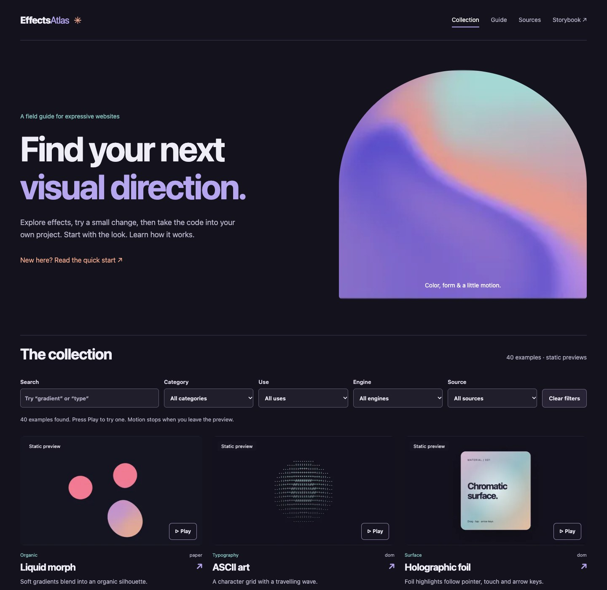

# Effects Atlas

[Explore the gallery](https://c-mongan.github.io/effects-atlas/) · [Read the guide](https://c-mongan.github.io/effects-atlas/#/guide) · [Storybook](https://c-mongan.github.io/effects-atlas/storybook/) · [CI checks](https://github.com/c-mongan/effects-atlas/actions/workflows/ci.yml)

**40 React examples for expressive websites: 28 visual effects and 12 practical recipes.** Browse static previews, try one animation, adjust supported settings, and download a working project. Source credits, motion controls, and browser fallbacks are part of each example.



## Find a useful detail

Search by name or filter by category, use, renderer, and source. Open an example to see its controls, copy the code, or download a React/Vite starter. Its URL keeps your selected settings. Gallery cards are static until you select Play; only one card animates at a time.

Three website compositions show effects in context: a product hero, a portfolio project card, and a feature section. The guide covers choosing an effect, installation, customisation, accessibility, performance, and attribution. Use a few details with purpose; animation is not a substitute for readable content.

## Take an example into your project

Download a starter from any example. Extract it, then run:

```sh
npm ci
npm run dev
```

The ZIP contains application source, styles, pinned dependencies, a lockfile, licences, and a local `effects-atlas.tgz`. There is no npm publication or account requirement. The downloaded application uses the same selected settings as the preview and copied code. Runtime assets are local; installation downloads dependencies from npm.

```tsx
import { Effect, Recipe } from "effects-atlas";
import "effects-atlas/styles.css";

<Effect id="mesh-gradient" settings={{ speed: 0.7, colors: ["#88c6c4"] }} />
<Recipe id="shared-layout-tabs" />
```

Existing `Effect` imports remain compatible. `Effect` and `Recipe` accept `id`, `paused`, `forceFallback`, optional `settings`, `className`, and `style`. Only supported settings are shown in the gallery. `effects` and `recipes` expose typed catalogues; `EffectId` and `RecipeId` identify their entries.

Original effects include gradients, foil, clay, print treatments, typography, particles, glass, pixel art and a Mandelbulb. New recipes:

| Foundation                          | Recipes                                                                    |
| ----------------------------------- | -------------------------------------------------------------------------- |
| Motion                              | Scroll reveal, spring card, shared-layout tabs                             |
| Motion Primitives design references | Word reveal, staggered features, animated panel                            |
| tsParticles                         | Linked particles, ambient particles, button-triggered confetti             |
| React Three Fiber + Drei            | Glass transmission, reflective pedestal, floating object with soft shadows |

The Motion Primitives recipes are original implementations inspired by the named patterns. No upstream component code is included. React Bits is a linked reference only. See [source and licence details](THIRD_PARTY_NOTICES.md) and [recipe sources](docs/RECIPE_SOURCES.md).

## Run the repository

Use Node **22.12+** and npm.

```sh
npm ci
npm run dev:gallery  # http://127.0.0.1:6008
npm run storybook   # separate terminal: http://127.0.0.1:6006
```

For downloads and legacy redirects in the local gallery, build the assembled site:

```sh
npm run build:site
node scripts/serve-gallery.mjs # http://127.0.0.1:6008
```

The site build combines the gallery, starter assets and Storybook. Existing `?path=/story/...` links and root iframe links redirect to `/storybook/`, preserving their parameters.

## Motion, capability and performance

Pause, reduced motion, hidden tabs and offscreen previews stop expensive rendering. Decorative GPU previews switch to original static artwork; that artwork is not a frozen animation frame. Interactive recipes retain their controls when motion stops. Confetti requires a button press and has a bounded lifetime.

GPU availability depends on browser, device and driver. Unsupported APIs display a labelled fallback. The heavy renderers load lazily; browsing static thumbnails does not start 40 GPU scenes. Install dependencies are broader than the code downloaded for a single runtime preview. No fixed FPS or battery claim is made.

## Test and contribute

```sh
npx playwright install chromium firefox webkit
npm run check          # types, units, library and Storybook builds
npm run test:stories   # all isolated stories
npm run test:browser   # Chromium effects and recipes
npm run test:firefox
npm run test:webkit
npm run test:no-gpu
npm run build:site
npm run test:gallery
npm run test:starters  # builds and browser-tests all 40 starter projects
npm run test:package
npm audit
```

Use `REQUIRE_GPU=1 npm run test:browser` on supported hardware to require native graphics. CI separates API unavailability from renderer failures. Firefox narrow-screen checks use viewport and touch support; they are not physical-phone tests. Playwright WebKit is separate from installed Safari. See [verification](docs/VERIFICATION.md) for measured scope and limitations.

The official Storybook MCP addon is available only through the local dev server at `http://127.0.0.1:6006/mcp`. With Storybook running, use `npm run test:mcp`. The static website has no MCP server. [MCP setup](docs/MCP.md) describes project-scoped connections.

CI verifies Chromium, Firefox and WebKit before deploying the gallery and Storybook to GitHub Pages. It never publishes an npm package. See [contributing](CONTRIBUTING.md), [security](SECURITY.md), and [release notes](docs/RELEASING.md). Original code is MIT; third-party notices remain in force.
