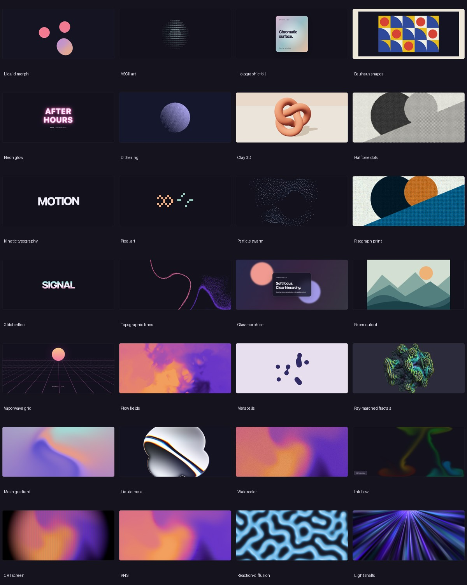

# Effects Atlas

[Open the live Storybook demo](https://c-mongan.github.io/effects-atlas/) · [CI checks](https://github.com/c-mongan/effects-atlas/actions/workflows/ci.yml)

A curated React visual-effects library and Storybook: **28 effects, 84 isolated stories**, explicit provenance, and GPU-independent previews.



## Start locally

Node **22.12+** and npm are required.

```sh
npm ci
npx playwright install chromium
npm run storybook
```

Open **http://127.0.0.1:6006**. Default animates, Paused shows an illustrative static preview, and Fallback demonstrates the same safe path without probing graphics APIs. Run `npm run build-storybook` for a static, hostable Storybook. No account, API key, remote images or font service is required.

## Use the React component

The repository builds an ESM package; it has not been published to npm. To try it in another project, run `npm pack` here and install the resulting tarball there.

```tsx
import { Effect } from "effects-atlas";
import "effects-atlas/styles.css";

export function Example() {
  return <Effect id="holographic-foil" />;
}
```

`Effect` accepts `id`, `paused`, `forceFallback`, `className` and `style`. `paused` is a caller-enforced pause; the built-in button can additionally pause an otherwise active effect. Reduced motion always takes priority. The exported `effects` catalogue contains names, rendering engines and source/license metadata. Individual effect recipes live under `src/effects/`; stories show the exact host props.

Pause, reduced motion and hidden tabs **unmount** live effects and display original static SVG artwork. These previews are representative illustrations, not screenshots of the last animation frame. GPU capability checks run before mounting WebGL2/WebGPU effects. Failed adapters, device initialization and WebGL context loss show a labelled static preview instead of a blank canvas. Client renderers are loaded lazily; server rendering starts with static artwork.

Foil supports pointer, touch and arrow-key input. Ink Flow has an initial demonstration stroke and an **Add ink stroke** keyboard button. Animations are decorative, with a readable heading, description and status outside the preview.

## Included effects

| Original twenty                                                           | Eight additions                  |
| ------------------------------------------------------------------------- | -------------------------------- |
| Liquid morph, ASCII art, holographic foil, Bauhaus shapes, neon glow      | Mesh gradient, liquid metal      |
| Dithering, clay 3D, halftone dots, kinetic typography, pixel art          | Watercolor, ink flow             |
| Particle swarm, risograph print, glitch, topographic lines, glassmorphism | CRT, VHS                         |
| Paper cutout, vaporwave grid, flow fields, metaballs, ray-marched fractal | Reaction-diffusion, light shafts |

Paper Shaders supplies most WebGL examples through a small set of licensed, locally patched React adapters. Shaders supplies optional WebGPU effects. Sprite Lite and Three.js supply pixels and clay. Several compositions are original or small credited adaptations. The risograph recipe is a Paper halftone interpretation rather than a redistributed copy of the older model demo. [Provenance and licenses](THIRD_PARTY_NOTICES.md) identify what is copied, adapted, depended on or original.

## Storybook MCP

The official `@storybook/addon-mcp` runs with the dev server at **http://127.0.0.1:6006/mcp**. Project configs are included for `.mcp.json` clients and VS Code. They do not modify global settings. Use your client's normal project trust/connection flow.

```sh
# With Storybook already running:
npm run test:mcp
```

The smoke test performs an actual protocol handshake, tool discovery and documentation queries. [MCP setup](docs/MCP.md) explains the tools and client configuration. A static Storybook build has no running MCP endpoint. Storybook's AI APIs are currently preview features.

## Checks

```sh
npx playwright install firefox webkit # additional test browsers
npm run check          # strict types, unit tests, library and Storybook builds
npm run test:stories   # Storybook's Vitest browser/a11y integration
npm run test:browser   # every effect at desktop/mobile + static states and interactions
npm run test:firefox   # Firefox desktop and narrow viewport checks
npm run test:webkit    # Playwright WebKit; separate from the installed Safari app
npm run test:no-gpu    # explicitly disable graphics APIs and check fallback/CI paths
npm run test:mcp       # running dev server required
npm audit
```

On a machine with supported native graphics, use `REQUIRE_GPU=1 npm run test:browser` to require live GPU rendering. Without that flag, a genuinely unavailable API is recorded as a tested fallback; runtime initialization failures still fail the default tests. Mobile checks use viewport/touch emulation, not physical devices. Firefox uses a 390px viewport with touch support because Playwright does not support its `isMobile` option. Playwright WebKit is tested separately from the installed Safari app. The repository does not claim fixed FPS, battery cost or universal browser compatibility. [Evaluation and known limits](docs/EVALUATION.md) describe the evidence.

To regenerate the overview images after the native suite, run `python3 scripts/contact-sheet.py` with Pillow installed.

CI installs Chromium, Firefox and WebKit in separate jobs, runs the checks and uploads browser reports/screenshots. The static Storybook is also uploaded as a build artifact. After GitHub Pages is enabled with GitHub Actions as its source and the repository variable `ENABLE_PAGES` is set to `true`, a push to the default branch deploys the verified Storybook only after every check passes. Pull requests run verification without deploying. CI does not publish npm packages or create repositories.

See [the local verification report](docs/VERIFICATION.md) for the exact checks and limits.

## Contribute and release

See [CONTRIBUTING.md](CONTRIBUTING.md), [SECURITY.md](SECURITY.md) and the [release checklist](docs/RELEASING.md). MIT applies to original Atlas code; third-party notices remain in force. No commercial design kit, proprietary skill or private evaluation asset is bundled.
