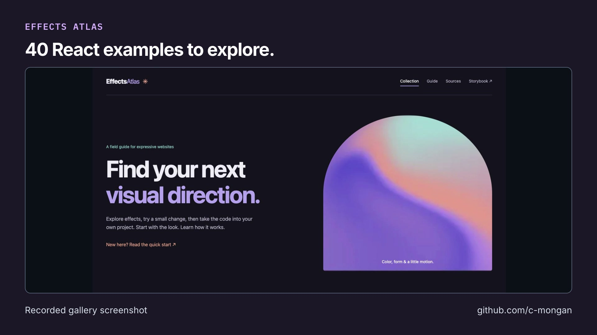

# Effects Atlas: short video overview

[Open or download the MP4](https://github.com/user-attachments/assets/e608e901-2675-45e5-8130-7932f0225aae) · [Transcript](transcript.txt) · [Captions (SRT)](captions.srt) · [Captions (VTT)](captions.vtt)

Recorded gallery screenshots. The project includes 28 effects and 12 recipes.

The video introduces the project; it does not replace its validation records or documented limits.

## Media details

- Duration: 21.833 seconds; 1920 × 1080; 30 fps; H.264 video and AAC audio.
- Published video SHA-256: `1abf94a477f12dad1b765cf804888a19494f5afb90b301e0e9ef6870abb767b2`.
- AI narration: Inworld TTS 2, using the voice selected by the project author.
- Music: *Happy Beats / Business Moves Vol. 10* by [Sascha Ende, ende.app](https://ende.app/en), licensed under [CC BY 4.0](https://ende.app/en/standard-license). The track is trimmed, faded, and mixed beneath speech.
- Story and video workflow: [Brag](https://github.com/latent-spaces/brag); rendered locally with [Hyperframes](https://github.com/heygen-com/hyperframes).

## Visual sources

- [README.md](https://github.com/c-mongan/effects-atlas/blob/64afb9dd545b12dca3fe50e4964c6bc2a0f5ab40/README.md) — source Git blob `298a310c11cbe017aff0bd2e49f9999c642333ad`.
- [gallery.jpg](https://github.com/c-mongan/effects-atlas/blob/64afb9dd545b12dca3fe50e4964c6bc2a0f5ab40/docs/screenshots/gallery.jpg) — source Git blob `b99325939847a65c58af7e13beb5015db72953d5`.
